# Parking Slot Allocation System

## Overview

Parking Slot Allocation System is a web application developed to automate parking management for a campus, office or housing society. It replaces paper registers with a system that allocates the nearest free slot, issues tickets, calculates parking fees on exit and reports occupancy and revenue.

The project was built following the software engineering process: requirements (SRS), design (UML and ER diagrams), implementation, and testing.

The project focuses on:
- Automatic slot allocation by vehicle type
- Accurate, rule-based billing
- Role-based access for Admin and Operator
- Documented requirements, design and test cases

---

## Features

- Role-based login (Admin and Operator) with hashed passwords
- Slot management: add slots in bulk by level and type, with automatic slot numbers
- Automatic allocation of the nearest free slot for two-wheelers and four-wheelers
- Vehicle number validation, duplicate entry check and "Parking full" handling
- Printable parking ticket and payment receipt
- Fee calculation: time rounded up to whole hours, minimum 1 hour, editable rates
- Live dashboard with free and occupied slots and currently parked vehicles
- Reports: occupancy, vehicles entered and billed, bills and revenue for any date
- User management for the Admin
- Unit tests and system tests with documented results

---

## Tech Stack

- Backend: Python (Flask)
- Database: MariaDB (accessed through PyMySQL)
- Frontend: HTML, CSS (Jinja2 templates)
- Testing: Python unittest

---

## Project Structure

```text
SE MINI PROJECT/
│
├── app.py
├── db.py
├── utils.py
├── config.py
├── init_db.py
├── schema.sql
├── requirements.txt
│
├── templates/
│   ├── base.html
│   ├── login.html
│   ├── dashboard.html
│   ├── entry.html
│   ├── ticket.html
│   ├── exit.html
│   ├── exit_bill.html
│   ├── receipt.html
│   ├── slots.html
│   ├── rates.html
│   ├── users.html
│   └── reports.html
│
├── static/
│   └── style.css
│
├── tests/
│   └── test_utils.py
│
├── docs/
│   ├── SRS_Parking_Slot_Allocation_System.pdf
│   ├── Test_Cases_Parking_Slot_Allocation_System.pdf
│   └── Parking_Slot_Allocation_Mini_Project.pdf
│
├── diagrams/
│   ├── use_case_diagram.png
│   ├── class_diagram.png
│   ├── sequence_diagram.png
│   ├── activity_diagram.png
│   └── er_diagram.png
│
├── screenshots/
│   ├── dashboard.png
│   ├── ticket.png
│   ├── bill.png
│   ├── receipt.png
│   ├── report.png
│   ├── already_parked.png
│   ├── invalid_number.png
│   ├── parking_full.png
│   ├── admin_access.png
│   ├── wrong_password.png
│   └── unit_tests.png
│
└── README.md
```

---

## Database Design

The application follows a relational database model with normalized entities and constraints.

## Tables Used

## Users

Stores login accounts and their role (Admin or Operator). Passwords are stored only as hashes.

## Slots

Stores every parking slot with its number, type (two-wheeler or four-wheeler), level and free or occupied status.

## Rates

Stores the first-hour and extra-hour charge for each vehicle type.

## Vehicles

Stores each vehicle number and its type.

## Tickets

Stores every entry: vehicle, slot, issuing user, entry time, exit time and status (OPEN or CLOSED).

## Bills

Stores the hours billed, amount and payment time for each paid ticket.

---

## Relationships
- One user can issue multiple tickets
- One slot can be used by multiple tickets over time (only one open at a time)
- One vehicle can have multiple tickets
- One ticket has at most one bill

---

## Software Engineering and Database Concepts Used
- Software Requirements Specification (SRS)
- UML modelling: use case, class, sequence and activity diagrams
- ER diagram and relational design
- Primary Keys, Foreign Keys, UNIQUE and CHECK constraints
- JOIN operations and aggregate queries (COUNT, SUM, GROUP BY)
- Transaction handling (close ticket, store bill and free slot together)
- Unit testing and system testing with test cases

---

## How to Run

1. Install **Python 3.9+** and **MariaDB**, and make sure MariaDB is running

2. Install dependencies
```
pip install -r requirements.txt
```

3. Set the database login (Windows Command Prompt)
```
set DB_USER=root
set DB_PASSWORD=your_password
```
On Linux or macOS use `export DB_USER=root` and `export DB_PASSWORD=your_password`.

4. Create the database, tables and starter data (18 slots, default rates, two users)
```
python init_db.py
```

5. Start the application
```
python app.py
```

6. Open the application
```
http://127.0.0.1:5000
```

Default logins (change them from the Users page):

| Role | Username | Password |
|---|---|---|
| Admin | admin | admin123 |
| Operator | operator | operator123 |

---

## System Workflow
1. Admin logs in, adds slots and sets the rates
2. Operator registers a vehicle entry by vehicle number and type
3. The system validates the input and checks the vehicle is not already parked
4. The nearest free slot of the matching type is allocated and a ticket is issued
5. On exit, the ticket is found by ticket number or vehicle number
6. The bill is calculated from the parked time and shown before payment
7. On payment, the ticket is closed, the bill is stored, the slot is freed and a receipt is issued
8. Admin views the dashboard and reports

---

## Billing Rule

Parked time is rounded up to whole hours (minimum 1 hour).

Fee = first-hour charge + extra-hour charge x (billable hours - 1)

| Vehicle type | First hour | Each extra hour |
|---|---|---|
| Two-wheeler | Rs 10 | Rs 5 |
| Four-wheeler | Rs 20 | Rs 10 |

Example: a four-wheeler parked for 2 hours 30 minutes is billed for 3 hours: 20 + 10 x 2 = **Rs 40**. The Admin can change the rates from the Rates page.

---

## Security Features
- Passwords stored as salted hashes
- Role-based access: admin pages are blocked for operators
- Parameterised SQL queries
- Atomic slot allocation so two vehicles never get the same slot
- A ticket cannot be paid twice
- Database credentials read from environment variables, not stored in code

---

## Testing

Run the unit tests:
```
python -m unittest discover -s tests -v
```

Test summary (details and evidence in `docs/Test_Cases_Parking_Slot_Allocation_System.pdf`):

| Category | Total | Passed |
|---|---|---|
| Unit tests (TC01-TC10) | 10 | 10 |
| System tests (ST-01 to ST-13) | 13 | 13 |

---

## Documents
- [Software Requirements Specification](docs/SRS_Parking_Slot_Allocation_System.pdf)
- [Test Case Document](docs/Test_Cases_Parking_Slot_Allocation_System.pdf)
- [Mini Project Report](docs/Parking_Slot_Allocation_Mini_Project.pdf)

---

## Diagrams

## Use Case Diagram
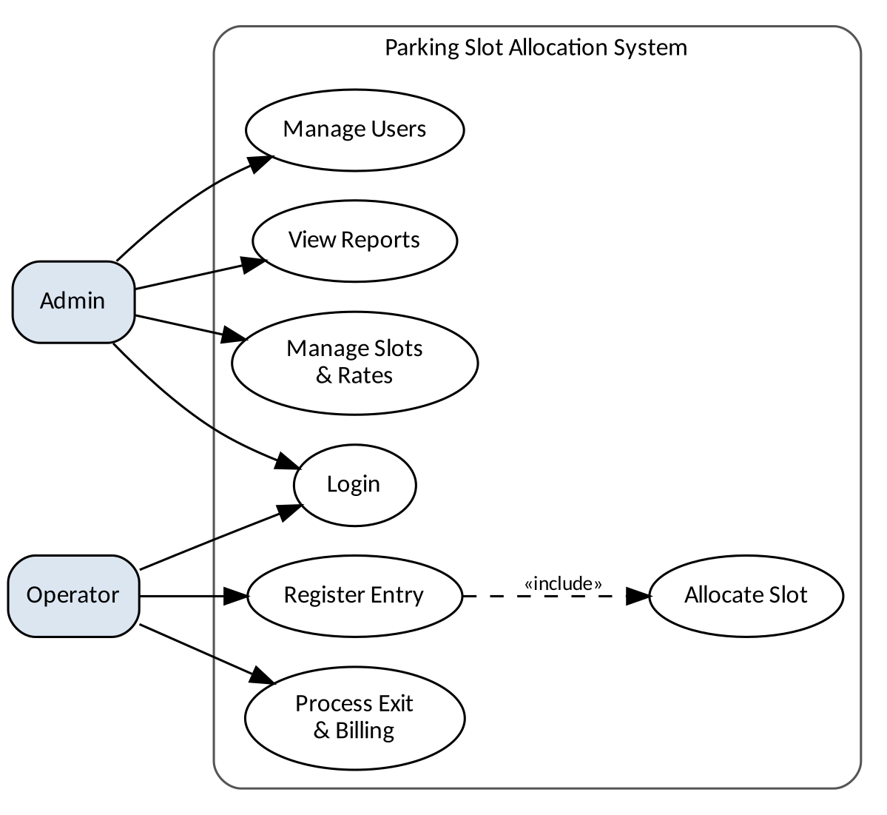

## Class Diagram
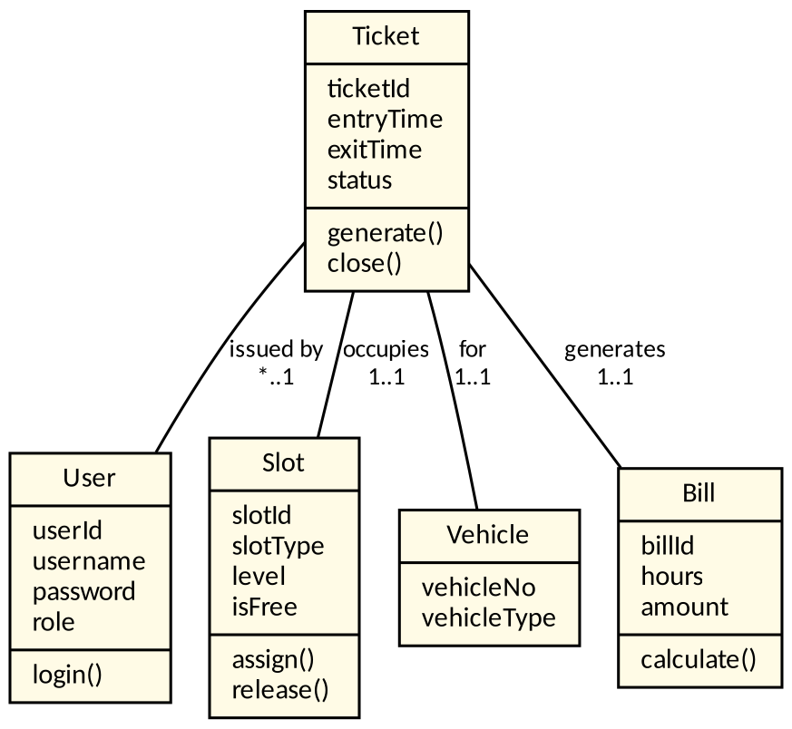

## Sequence Diagram
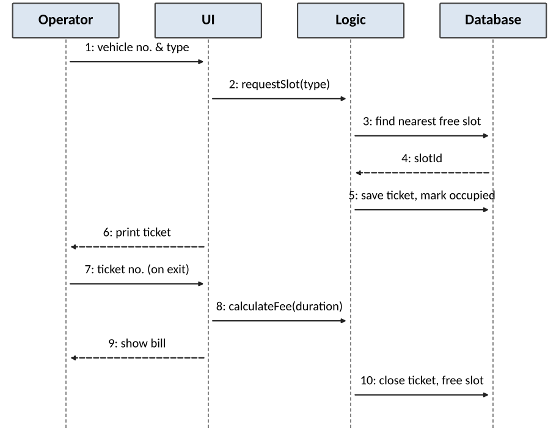

## Activity Diagram
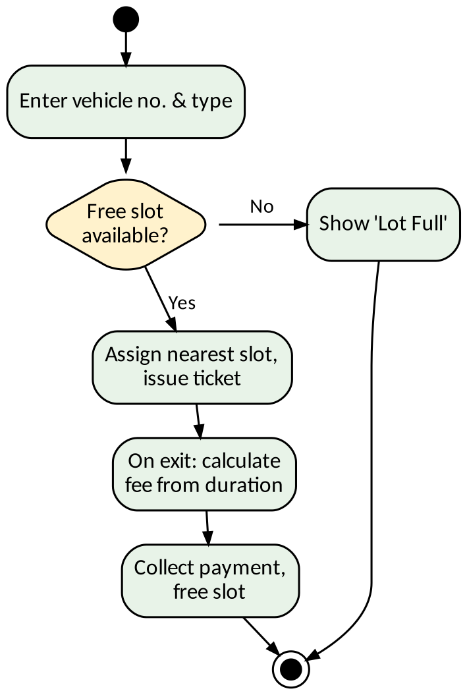

## ER Diagram
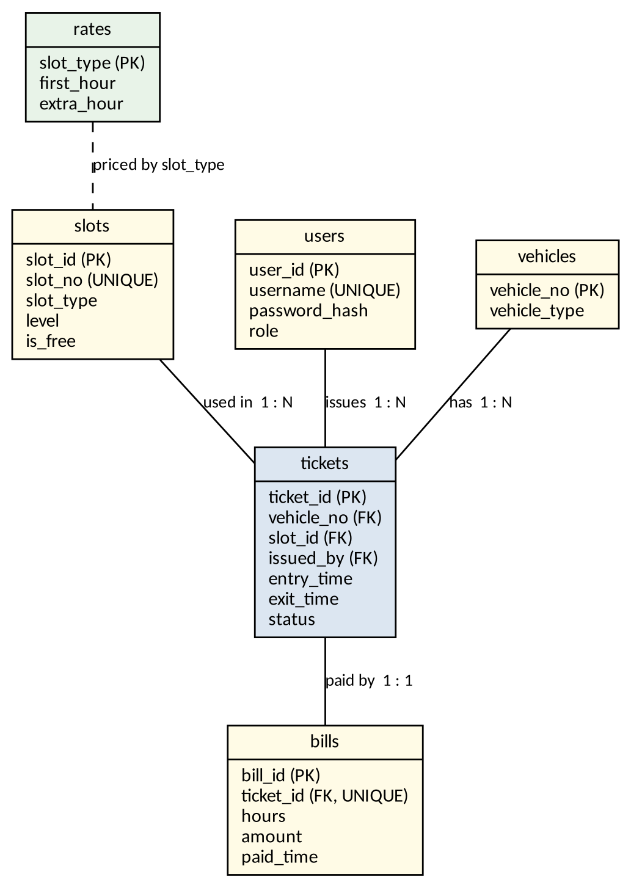

---

## Screenshots

## Dashboard
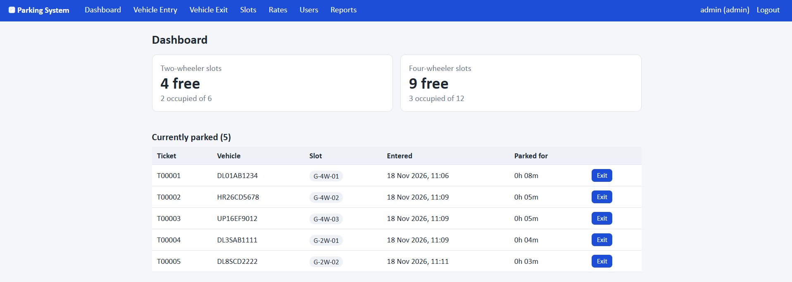

## Parking Ticket
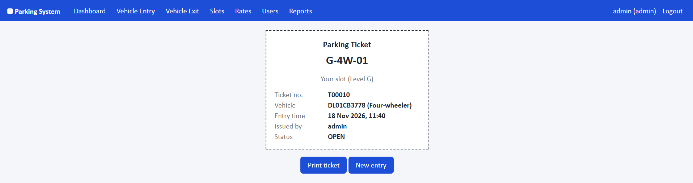

## Bill Before Payment
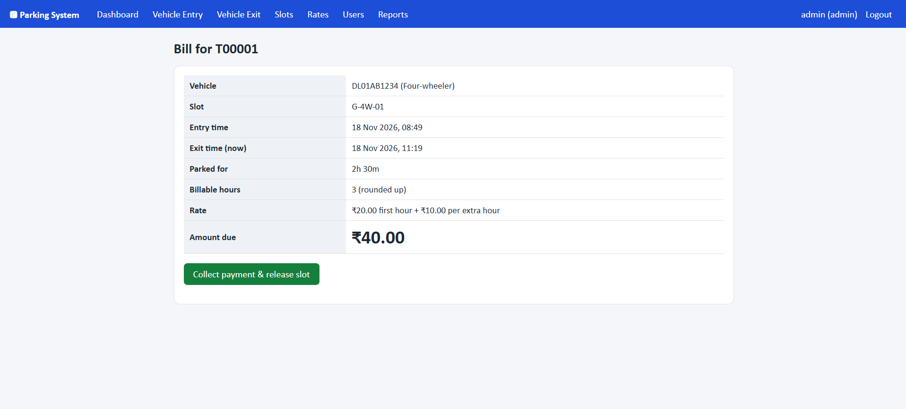

## Receipt
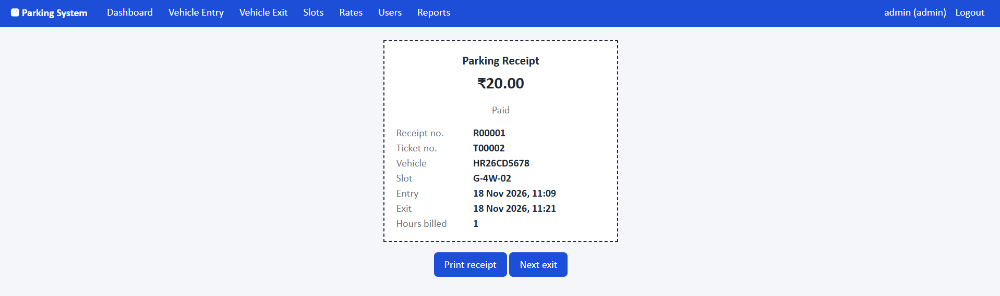

## Reports
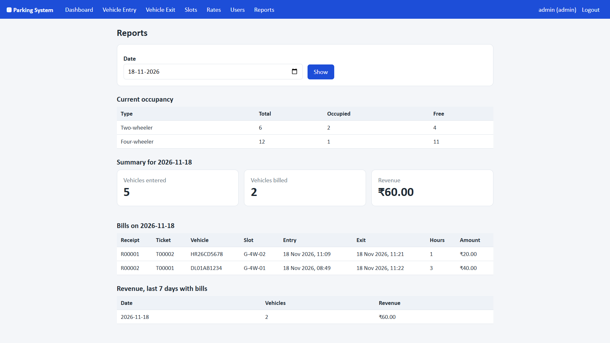

## Duplicate Entry Rejected
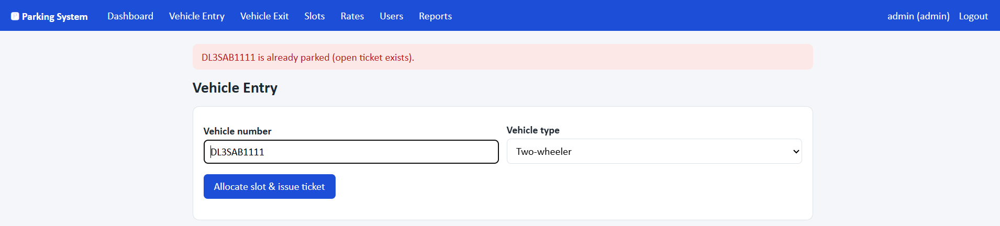

## Invalid Vehicle Number
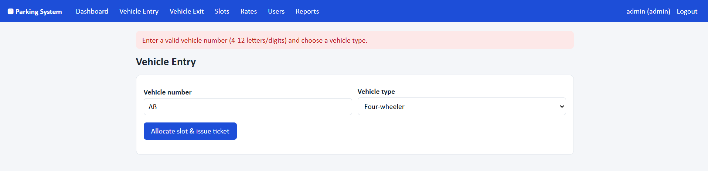

## Parking Full
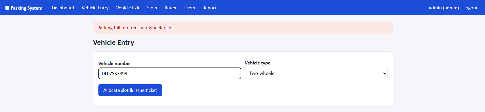

## Operator Blocked from Admin Pages
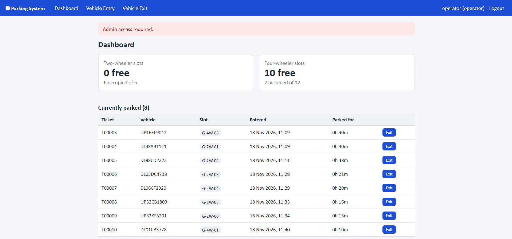

## Wrong Password
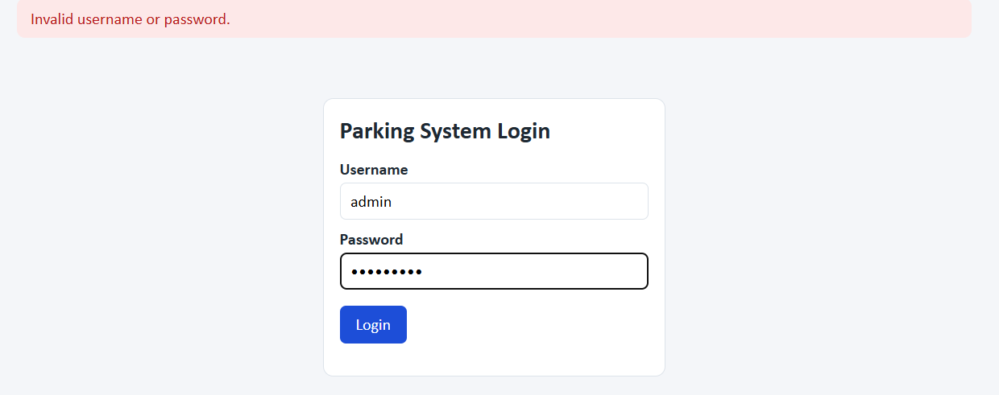

## Unit Tests
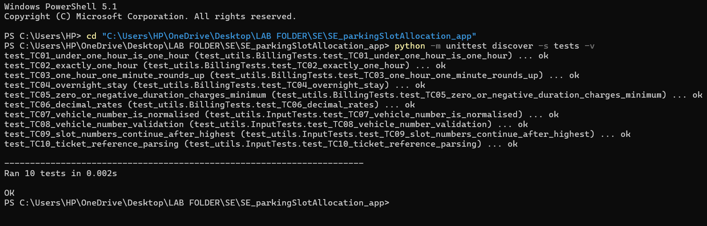

---

## Future Enhancements
 - Advance slot booking
 - Monthly pass holders
 - Overstay penalty
 - Number-plate recognition
 - Online payment
 - CSRF protection and password reset
 - Mobile app for vehicle owners

---

## Author
Rohit Gupta

---

## Note

This project is created for academic purposes (Software Engineering) and demonstrates the software engineering process: requirements specification, UML design, implementation with a relational database, and testing.
